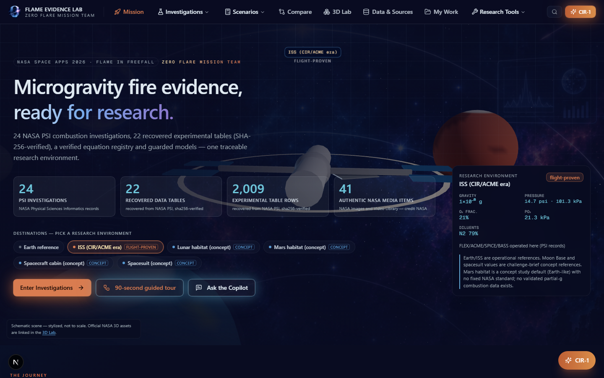

# ZERO FLARE — Flame Evidence Lab

Research decision support for exploring NASA microgravity combustion evidence, comparing investigations, and working with **CIR-1**, a tool-grounded research copilot.

> Source-and-documentation snapshot. The original runtime configuration, generated datasets, model artifacts, and public assets still need to be restored before the application can run. This is not a certified spacecraft fire-protection system.



## What the platform offers

| Workspace | Purpose |
| --- | --- |
| Mission | Select an environment and discover evidence coverage. |
| Investigations | Inspect metadata, tables, equipment, media, equations, graphs, and gaps. |
| Compare | Review scientific comparability before cross-study interpretation. |
| Scenarios | Explore prevention, detection, prediction, and suppression questions. |
| 3D Lab | Inspect equipment models with explicit fidelity labels. |
| Data & Sources | Review provenance, source registries, ingestion receipts, and recovery status. |
| My Work | Save research items, gaps, and sessions; export evidence packets. |
| Research Tools | Access scientific equations, model cards, diagnostics, and evaluation. |

## Architecture

- **Interface:** Next.js App Router, React, TypeScript, Tailwind CSS, and shared UI primitives.
- **State:** Zustand and browser persistence, with hash links for navigation.
- **Visualization:** Recharts and Three.js / React Three Fiber / Drei.
- **Science:** deterministic equations, comparability checks, facility analysis, and guarded model scores.
- **AI:** server-side `z-ai-web-dev-sdk` orchestration of scientific tools; source-document lexical retrieval and external NASA searches.
- **Storage:** generated JSON, runtime filesystem records, and browser-local research state; a Prisma SQLite schema is included.

Static inspection of this upload identifies **8 views, 8 API route files, 34 registered CIR-1 tools, and 63 equation declarations**. These are source counts, not runtime validation results.

## Documentation

- [Consolidated project documentation](docs/PROJECT_DOCUMENTATION.md)
- [Download documentation as PDF](docs/ZERO_FLARE_Project_Documentation.pdf)
- [Download editable Word documentation](docs/ZERO_FLARE_Project_Documentation.docx)
- [Documentation index and report status](docs/README.md)
- [Architecture decisions](docs/FINAL_ARCHITECTURE_DECISIONS.md)
- [Scientific evidence and provenance](docs/SCIENTIFIC_EVIDENCE_AND_PROVENANCE_GUIDE.md)
- [Model cards and validation](docs/MODEL_CARDS_AND_VALIDATION_REPORT.md)
- [Historical testing report](docs/FINAL_TESTING_AND_ACCEPTANCE_REPORT.md)

The screenshots and individual reports were supplied with the project. They describe earlier project runs and are not evidence that this incomplete checkout has been run successfully. The consolidated document distinguishes inspected source behavior from historical claims.

## Repository layout

```text
src/app/                 Entry page and API handlers
src/components/          Product UI, charts, 3D scenes, shared primitives
src/lib/agent/           CIR-1 orchestration and tool registry
src/lib/science/         Equations, model guards, comparability, scenarios
src/lib/data/            Typed access to generated artifacts
src/lib/ingest/          Upload extraction, persistence, and governance
src/lib/external/        NASA research integrations
prisma/                  Research persistence schema
tests/                   Browser and runtime test sources
docs/                    Reports, screenshots, and consolidated documentation
```

## Setup: restore the complete project first

This repository contains the source and supporting materials uploaded by the owner. It does **not** yet contain all artifacts required to install or build it.

Restore these original files from the complete project:

1. `package.json`, the authoritative lockfile, and root Next.js / TypeScript / styling configuration.
2. `data/generated/*.json`, raw experimental data, and manifests.
3. `models/flex-extinction/v2/model_card.json` and other referenced model artifacts.
4. Required `public/` assets and `knowledge/` indexes.
5. Acquisition, generation, and model-evaluation scripts.

Then use the Node version, package manager, and scripts declared by the restored project. Do not install from an invented replacement manifest or mix lockfiles. Configure provider access on the server and durable storage for ingestion. Keep `.env` and credentials out of Git.

The Prisma datasource uses `DATABASE_URL`. A schema alone does not establish a database-backed user workflow; the supplied interface primarily persists user research state in the browser.

## Scientific boundaries

- Missing data must not be silently converted to measurements or zero values.
- Microgravity evidence does not establish lunar or Martian validation.
- FLEX refuses inputs beyond explicit domain limits, including gravity above 0.02 g.
- Model outputs and heuristic facility scores are not certified safety verdicts.
- Uploading files does not train or automatically promote models.
- Schematic equipment views are not fire simulations or validated digital twins.
- Historical model metrics require the actual artifacts and evaluation procedure for reproduction.

## Testing status

This snapshot was reviewed statically for documentation. A fresh install, typecheck, lint, production build, browser suite, live provider evaluation, and model-metric reproduction have **not** been executed on it. Historical reports should be read with their dates and scope.

After restoring the complete project, run its declared checks and evaluate `/api/selftest` and `/api/scientific-qa-eval`. Preserve logs and artifact hashes for the actual release.

## NASA resources and attribution

The implementation references [NASA Physical Sciences Informatics](https://psi.nasa.gov/), [NASA NTRS](https://ntrs.nasa.gov/), and the [NASA Images and Video Library](https://images.nasa.gov/). Preserve accession identifiers, per-asset credits, source URLs, retrieval dates, and applicable reuse terms. No NASA affiliation or endorsement is claimed.

## AI assistance

ChatGPT assisted with repository preparation, this README, and consolidated documentation from the uploaded project materials. The team should separately document AI tools used in the underlying code and individual assets.

## License

No project-wide license has been selected. The owner should confirm ownership and third-party reuse terms before choosing one. External data, media, dependencies, and models retain their applicable terms.
